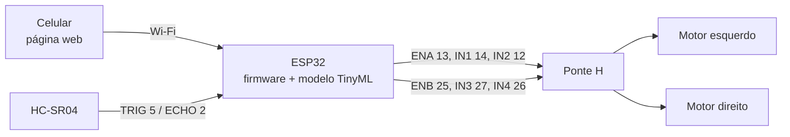
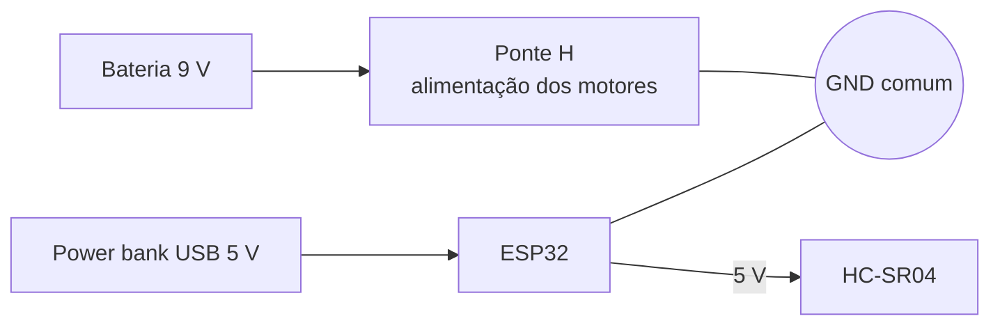

# Hardware e mecânica

Documentação da montagem física do carrinho na versão usada no CP1 e no CP2. A pinagem abaixo é a que está no firmware ([`src/carrinho/carrinho.ino`](../src/carrinho/carrinho.ino)); se a montagem mudar, os dois precisam ser atualizados juntos.

## Componentes

| Componente | Qtd. | Função |
|---|---|---|
| ESP32 DevKit | 1 | controle, servidor web (Wi-Fi AP) e inferência TinyML |
| Ponte H dupla (entradas ENA, IN1–IN4, ENB) | 1 | acionamento e controle de velocidade dos motores |
| Motor DC com redução (TT) + roda | 2 | tração diferencial |
| Roda boba | 1 | apoio traseiro |
| Sensor ultrassônico HC-SR04 | 1 | distância frontal (entrada do modelo TinyML) |
| Chassi 2WD comercial em acrílico | 1 | estrutura |
| Bateria 9 V | 1 | alimentação dos motores |
| Power bank USB | 1 | alimentação do ESP32 |

Preços e links de compra: [`organizacao/Custos/Planilha_de_custos.xlsx`](../organizacao/Custos/Planilha_de_custos.xlsx).

## Pinagem

| Sinal | GPIO do ESP32 | Destino |
|---|---|---|
| ENA (PWM) | 13 | ponte H, motor A |
| IN1 | 14 | ponte H, motor A |
| IN2 | 12 | ponte H, motor A |
| ENB (PWM) | 25 | ponte H, motor B |
| IN3 | 27 | ponte H, motor B |
| IN4 | 26 | ponte H, motor B |
| TRIG | 5 | HC-SR04 |
| ECHO | 2 | HC-SR04 |

## Diagrama de blocos

## Diagrama de alimentação

Os motores e a lógica ficam em fontes separadas para que os picos de corrente na partida dos motores não reiniciem o ESP32. O GND precisa ser comum entre ponte H e ESP32, senão os sinais de controle não têm referência.

## Mecânica

O chassi é o 2WD comercial em acrílico (duas rodas motrizes e uma roda boba), sem carenagem nesta versão. O HC-SR04 fica fixado na frente, centralizado e paralelo ao solo, porque o modelo foi treinado com leituras nessa posição: mudar altura ou ângulo do sensor altera as distâncias medidas e exige nova coleta.

| Item | Posição no chassi |
|---|---|
| HC-SR04 | frente, centralizado |
| ESP32 | plataforma superior |
| Ponte H | plataforma superior, próxima aos motores |
| Bateria 9 V e power bank | plataforma inferior, para baixar o centro de gravidade |

### Evolução do projeto

| Versão | Mudança | Motivo |
|---|---|---|
| Planejamento (MVP) | 4 rodas, Wi-Fi + Bluetooth, carenagem impressa em 3D | escopo inicial em [`organizacao/MVP/MVP.md`](../organizacao/MVP/MVP.md) |
| CP1 | chassi 2WD comercial, controle só por Wi-Fi, sem carenagem | o Wi-Fi nativo do ESP32 já atende o controle pelo celular sem módulo extra |
| CP2 | mesmo chassi; sensor passa a alimentar o modelo TinyML e a ponte H recebe PWM | velocidade controlada pela classe inferida |

## Pontos de atenção elétricos

O ECHO do HC-SR04 sai em 5 V e está ligado direto ao GPIO 2, que tolera 3,3 V. Funciona na prática, mas o correto é um divisor resistivo (por exemplo 1 kΩ e 2 kΩ) para não degradar o pino. Os GPIO 2 e 12 também são pinos de *strapping* do ESP32: se algo os mantiver em nível alto durante o boot, a placa pode não iniciar, então, se o carrinho falhar ao ligar, desconecte esses dois fios, ligue e reconecte.
